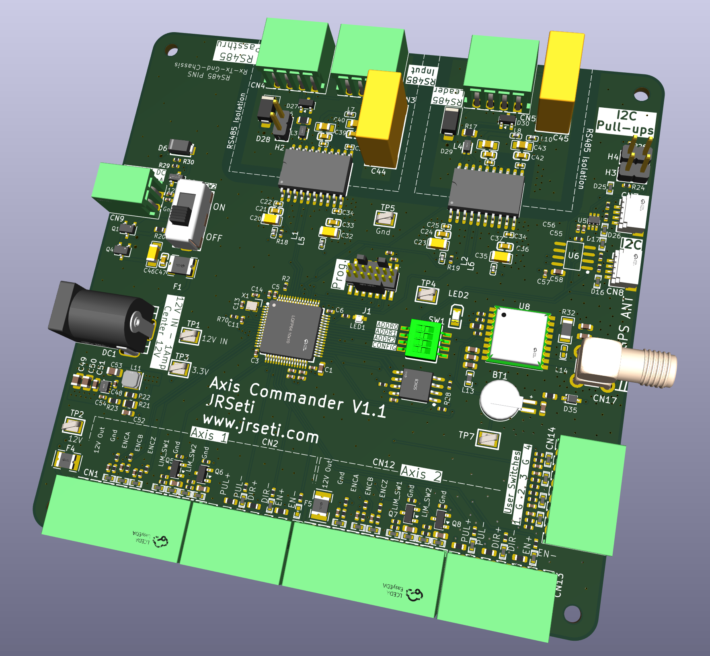
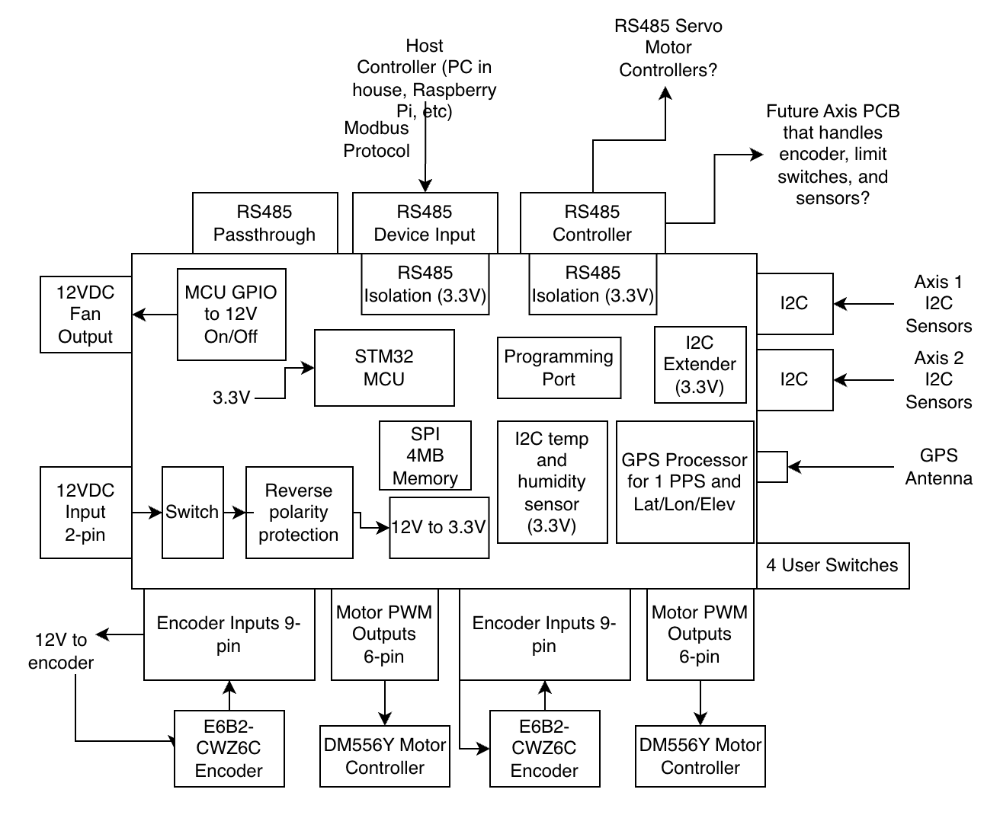
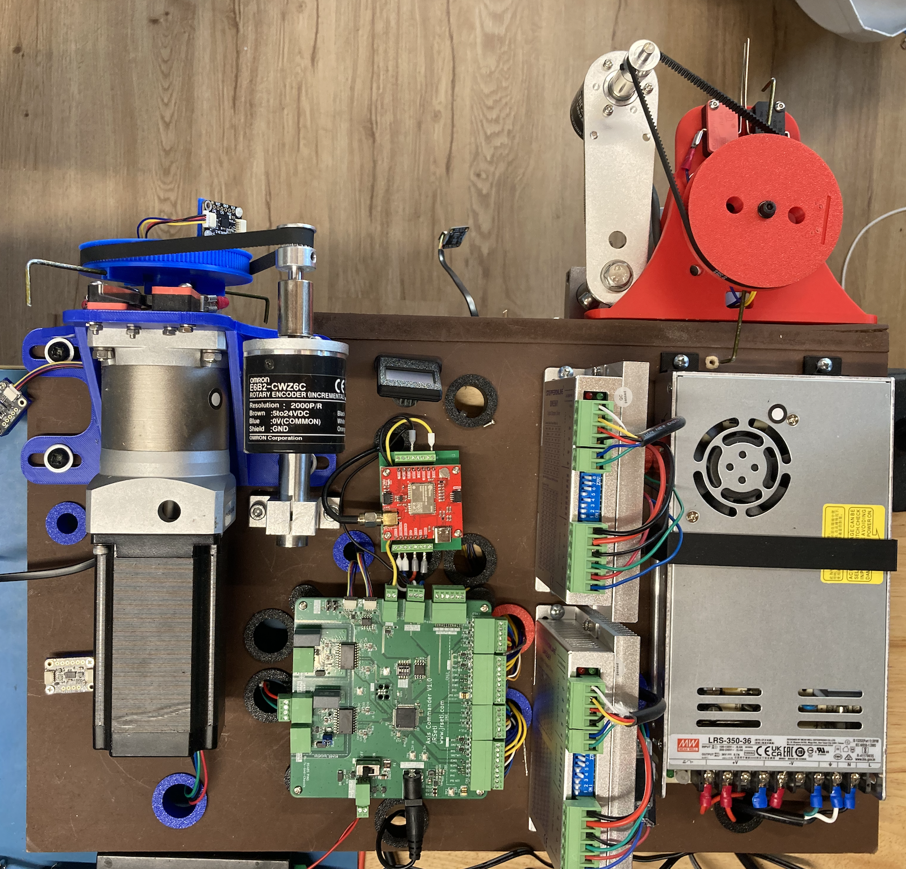
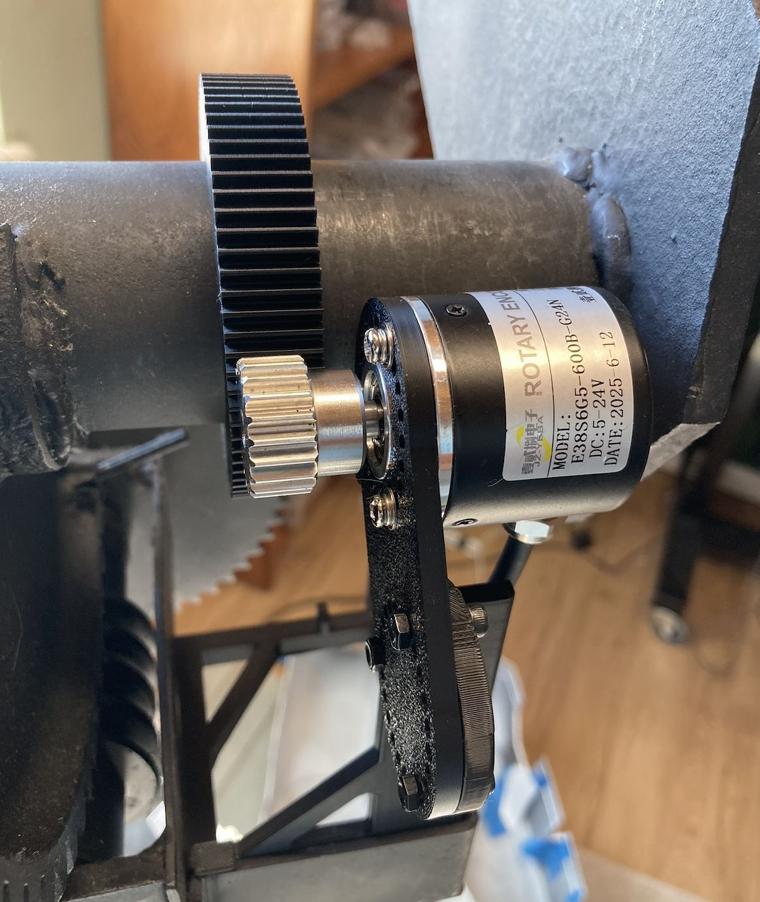

# Axis Commander — A Universal Dish Positioning Controller

*An open-source motion controller for radio astronomy dishes of any size*

---

## Overview

The **Axis Commander** is a compact (10 × 10 cm) two-axis motion controller designed to point and track satellite and radio astronomy dishes. It grew out of my own project to automate a **3-meter MIT Small Radio Telescope (SRT) dish**, but a core design goal from day one was to make something that scales — affordable and practical for **smaller dishes**, while still capable enough for **larger installations**.

The philosophy is simple: one well-designed, open board that a hobbyist, a university, or an observatory can pick up, adapt, and deploy without reinventing the motion-control layer every time.

The controller only handles the motion of a satellite dish. It does not control anthing related to the signal chain.

A few things that make it approachable:

- **Open source** — the full design will be released so anyone can build, modify, or extend it.
- **Affordable** — boards run roughly **$150 for two assembled units** (plus tariffs and customs), fabricated and assembled through **JLCPCB**. Can we get that down to $50/board in quantity?
- **Standard tooling** — designed entirely in **KiCad**, so the schematics and layout are open and easy for others to work with.
- **Standard communication** — the host talks to the board over **Modbus (RS485)**, a protocol already familiar in industrial and observatory environments.
**Room to row** - see the 3D rendering. There is room to add other capability as we see fit.

The result is a controller you can install into an existing dish, wire up your motors and sensors, and command from a PC or Raspberry Pi in the control room.

---

## How It Works — The Big Picture

The board sits between your **host controller** (a PC in the house or control room, a Raspberry Pi, an observatory control system) and the **motors, encoders, and sensors** out on the dish. The communication is over RS485, which can be used over very long distances.The host issues high-level position commands over Modbus; the Axis Commander handles the real-time motion and feedback for **two independent axes** (typically azimuth and elevation).

The host can be a PC or Raspberyy Pi or any type of computer. Python scripts control the board remotely over RS485. I'll be using Python scripts on my MAC to get pointing information, and download that to the controller, and the controller handles the tracking. The controller will have a velocity/position loop to precisely control the positioning.

Importantly, the board does **not** drive motors directly. It outputs **low-power step/direction pulses** to an external motor driver — for example, a **DM556Y** — which supplies the actual motor current. This keeps the controller small, cool, and flexible: you choose a motor driver sized for your dish, from a small stepper to something much larger, without changing the controller.

---

## What It Does — Inputs & Outputs

### Motion control (per axis, ×2)

- **Motor pulse outputs (6-pin)** — low-power step/direction/enable pulses to an external driver such as the DM556Y. Currently being tested with **stepper motors**, but because the output is a standard pulse interface, or optionally RS485, it isn't limited to steppers.
- **Encoder inputs (9-pin)** — reads simple pulse (quadrature + index/Z) feedback from a shaft encoder such as the **Omron E6B2-CWZ6C**, so the controller knows the true position of each axis.
- **12 V supply to the encoder** — the board provides power out to the encoder on each axis.

### Communication

- **RS485 Device Input (Modbus)** — the primary command channel from the host controller. There's also an **RS485 passthrough** so multiple devices can be chained on the bus.
- **Second RS485 port (Modbus Controller)** — a separate RS485 master port so the MCU can drive **RS485 servo motors or other downstream devices**, opening the door to servo-based axes or auxiliary equipment.
- **Isolation** — both RS485 ports are **galvanically isolated** from the rest of the circuitry. Because RS485 cable runs to a dish can be long and exposed, this protects the controller from dangerous voltage spikes on those lines.

### Sensing & positioning

- **On-board I²C extender** — lets you place **I²C sensors (temperature, humidity, etc.) at each axis**, out on the moving structure, rather than only at the board.
- **GPS input** — accepts a GPS receiver providing **1 PPS timing** and **latitude / longitude / elevation**, giving the dish an accurate time and position reference for pointing and tracking.
- **On-board temperature sensor** — monitors the controller's own environment.

### Power & housekeeping

- **12 VDC input** (2-pin) with a power switch, reverse-polarity protection, and on-board 12 V → 3.3 V regulation.
- **12 VDC fan output** — the MCU can switch a **12 V cooling fan** on and off as needed.
- **SPI flash memory** — on-board storage for configuration and data.
- **User switches** — four general-purpose switches for configuration or local control.
- **Programming port** — for firmware development and updates.

---

## Why It's a Good Fit for an Observatory

- **Scales across dish sizes.** The same controller works whether the motor driver behind it is small or large — you size the driver, not the controller.
- **Isolated, robust field wiring.** Long RS485 and sensor runs are expected and protected against.
- **Sensors where you need them.** Per-axis I²C means environmental monitoring right at the moving structure.
- **Accurate time and position.** Built-in GPS (1 PPS + position) supports precise pointing and tracking.
- **Open and adaptable.** KiCad source, open licensing, and a standard Modbus interface.

## Software

The firmware that runs on the STM32 MCU is wriiten in C. I use the STM32CubeMX software do define the pin functions and their various parameters. 

The communication from my host computer to the board is RS485 Modbus. 

I envision all host side software will be Python.

AI is really good at helping write this type of software. The firmare is easy for Claude, and creating the host host Python applications and Modbus specification are a breeze.

## Curent status

I've tested the board's compoments using a custom Python app on the host computer to send Modbus testing commands.

All board components function except the MCU misses encoder ticks if the axis moves too fast. This issue is caused by incorrect resistor/capacitor combinations at the encoder inputs. I have corrected this for the next iteration.

Since I needed to spin another board I decided to incorporate on-board GPS. This supplies exact datetime and 1 PPS to the MCU. Also the GPS NMEA sentences provide Lat/Lon/Elevation of the dish.

I currently do not have the positioning loop working yet. That will be the next phase of development after I receive the next board revision.

Here is my bench setup. The blue is the elevation axis, the red is the azimuth axis. 

When I worked at the Allen Telescope Array we had a similar setup. A bench installation named "Antenna 0". It totally functioned like a real satellite dish, at least with the motion control (obviously no RF input.) This is really useful in case some hardware or software issue crops up on the real dish, it can be replicated on the bench.

I will get everything working on the test setup, then install as identical hardware on the real dish.

Note that on the real dish I do not have a pulley system like the bench. I 3D printed (in PTEG) a gear and encoder mount. Looks and works great!

